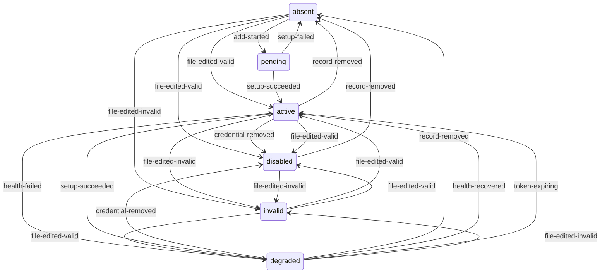

# Connection lifecycle

A model, HTTP, remote MCP, stdio MCP, email, or Discord connection: its
declaration, its credential, and its health. Host-repository and host-store
connections follow the governed resource lifecycle (`REPO-4EB2390E`,
`STORE-4C006F7D`), which needs its own lifecycle file.

## Ownership

- **Created by:** `integral connection add`, after authentication and any
  verification or discovery succeed, or by a manual edit of the connection file.
- **Removed by:** `integral connection rm`, or by a manual edit.
- **Identity:** the connection name. The declaration lives in
  `connections/<name>.toml` and the credential in `credentials/<name>`.
- **Health:** written by the gateway (OAuth refresh), the runner (MCP probes and
  stdio sidecar start), and the coordinator (Discord listener) to
  `state/connection-health/<name>.json`.
- **Dependents:** each committed change advances the connection generation
  (`CONFIG-58A1E7C3`). That generation drives the gateway's candidate set, the
  coordinator's model catalog, and replacement of stale
  [Pi sessions](pi-session.md). Conversation selections and schedules refer to
  connections by name.

## States

| State | Meaning | Recorded in | After a crash |
| --- | --- | --- | --- |
| `absent` | No declaration exists. | Nothing, apart from an orphan credential that an interrupted setup may leave. | Unchanged. |
| `pending` | `connection add` is collecting input, authorizing, verifying, or discovering. | CLI process memory only. | Lost. Nothing was committed, apart from a credential written just before its declaration. |
| `active` | The declaration is valid, the credential is usable, and no health mark exists. | Declaration and credential files. | Re-read from disk. |
| `degraded` | As `active`, but a health check failed. | A health mark naming the failing stage. | Re-read from disk; the OAuth retry delay restarts. |
| `disabled` | The declaration is valid but has no usable credential. | Declaration without a credential, with an expired OAuth credential that has no refresh token, or missing a stdio secret. | Re-read from disk. |
| `invalid` | The declaration file fails validation. | The invalid file. | Re-read from disk. |

## Events

| Event | Source |
| --- | --- |
| `add-started` | The user runs `connection add` for this name. |
| `setup-succeeded` | Authentication, verification, and discovery succeeded and the CLI committed the result. |
| `setup-failed` | Authentication, verification, or discovery failed or timed out, or the declaration was rejected. |
| `setup-interrupted` | The CLI process died or the terminal closed during setup. |
| `credential-removed` | The user confirmed credential removal in `connection rm`. |
| `record-removed` | The user confirmed removal of the declaration in `connection rm`. |
| `health-failed` | An OAuth refresh, MCP probe, catalog refresh, stdio sidecar start, or Discord listener failed. |
| `health-recovered` | A later check of the failed stage passed. |
| `token-expiring` | An OAuth access token is within one minute of expiry. |
| `file-edited-invalid` | A manual edit left the declaration invalid. |
| `file-edited-valid` | A manual edit left a valid declaration. |
| `server-start` | `integral server start` loads connections. |

## Transitions

| From | Event | To | Outcome | Contract |
| --- | --- | --- | --- | --- |
| `absent` | `add-started` | `pending` | Runs guided or explicit setup with the chosen authentication method. | CONNECTION-03C4E791, CONNECTION-2F7C9A61, CONNECTION-512D9A25 |
| `absent` | `setup-succeeded` | — | Setup commits only from `pending`. | impossible |
| `absent` | `setup-failed` | — | Setup fails only from `pending`. | impossible |
| `absent` | `setup-interrupted` | — | No setup is running. | impossible |
| `absent`, `pending` | `credential-removed` | — | `connection rm` finds no committed connection with this name and changes nothing. | ignored |
| `absent`, `pending` | `record-removed` | — | `connection rm` finds no committed connection with this name and changes nothing. | ignored |
| `absent`, `pending` | `health-failed` | — | Health checks run only on committed declarations. | impossible |
| `absent`, `pending`, `disabled` | `health-recovered` | — | No check runs that could recover. | impossible |
| `absent`, `pending` | `token-expiring` | — | No committed credential exists to refresh. | impossible |
| `absent` | `file-edited-invalid` | `invalid` | The gateway excludes the declaration and reports degraded health. | CONFIG-B6D29F40 |
| `absent` | `file-edited-valid` | `active` or `disabled` | The gateway adopts the declaration in a new generation. | CONFIG-58A1E7C3 |
| `absent` | `server-start` | — | There is nothing to load. | ignored |
| `pending` | `add-started` | ? | Should a second setup for the same name be refused while one is pending? Today nothing serializes them, so both can commit and the last writer wins. | open |
| `pending` | `setup-succeeded` | `active` | Stores the credential and declaration, advances the generation, and makes the connection available to new sessions. | CONNECTION-46E90D69, CONNECTION-4B8D73F1, CONNECTION-0EF2CF89, CONNECTION-1D691391, CONFIG-58A1E7C3 |
| `pending` | `setup-failed` | `absent` | Explains the failing stage without storing a partial declaration or credential. | CONNECTION-4B8D73F1, CONNECTION-0EF2CF89, CONNECTION-8F14C3B7, CONNECTION-1D691391 |
| `pending` | `setup-interrupted` | ? | Today nothing persists if the CLI dies during authorization, but a death after writing the credential and before writing the declaration leaves an orphan credential file. Should commit write the declaration last and sweep orphan credentials? | open |
| `pending` | `file-edited-invalid` | — | Manual edits during setup are unsupported; the setup commit replaces the file. | ignored |
| `pending` | `file-edited-valid` | — | Manual edits during setup are unsupported; the setup commit replaces the file. | ignored |
| `pending` | `server-start` | — | Pending setup lives only in the CLI process. | ignored |
| `active` | `add-started` | `active` | Treats the add as a credential rotation; the existing credential stays in use while authorization runs. | CONNECTION-634C2DA7 |
| `active` | `setup-succeeded` | `active` | Replaces the credential atomically, keeps the configuration, and advances the generation. | CONNECTION-634C2DA7 |
| `active`, `degraded` | `setup-failed` | — | A failed rotation writes nothing; the existing credential stays in use. | ignored |
| `active`, `degraded` | `setup-interrupted` | — | Rotation writes the credential atomically or not at all. | ignored |
| `active` | `credential-removed` | `disabled` | Removes every credential and keeps the declaration. | CONNECTION-741C2F56 |
| `active` | `record-removed` | `absent` | Removes the declaration and prevents new chats from selecting it. | CONNECTION-741C2F56, CONNECTION-E73B40C6 |
| `active` | `health-failed` | `degraded` | Marks only that connection degraded with a bounded reason; other connections keep working. | CONNECTION-512D9A25, MCP-6F5CFA0E, MCP-5751370A |
| `active` | `health-recovered` | — | The connection is already active. | ignored |
| `active` | `token-expiring` | `active` | The gateway refreshes the token before use and stores it atomically. | CONNECTION-512D9A25 |
| `active`, `degraded`, `disabled` | `file-edited-invalid` | `invalid` | The gateway keeps the other declarations, excludes this one, and reports degraded health. | CONFIG-B6D29F40 |
| `active` | `file-edited-valid` | `active` or `disabled` | The gateway adopts the edit in a new generation. | CONFIG-58A1E7C3 |
| `active` | `server-start` | `active` | Satisfies the startup requirement for a usable model connection. | CONNECTION-20778353, CONNECTION-D20F6A85 |
| `degraded` | `add-started` | `degraded` | Treats the add as a credential rotation. | CONNECTION-634C2DA7 |
| `degraded` | `setup-succeeded` | `active` or `degraded` | An OAuth replacement is tried at once; the mark clears when the next check passes. | CONNECTION-634C2DA7, CONNECTION-512D9A25 |
| `degraded` | `credential-removed` | `disabled` | Removes every credential and keeps the declaration. | CONNECTION-741C2F56 |
| `degraded` | `record-removed` | `absent` | Removes the declaration and its health mark. | CONNECTION-741C2F56, CONNECTION-E73B40C6 |
| `degraded` | `health-failed` | `degraded` | Keeps the mark and backs off before the next OAuth retry. | CONNECTION-512D9A25 |
| `degraded` | `health-recovered` | `active` | Clears the mark and makes the connection available again without recreating it. | MCP-6F5CFA0E, CONNECTION-512D9A25, CONNECTION-D3A3EDE9 |
| `degraded` | `token-expiring` | `degraded` or `active` | Retries the refresh once the retry delay expires. | CONNECTION-512D9A25 |
| `degraded` | `file-edited-valid` | `degraded` | The gateway adopts the edit in a new generation; the mark stays until a check passes. | CONFIG-58A1E7C3 |
| `degraded` | `server-start` | `degraded` | The server starts, and the gateway may retry and clear the mark. | CONNECTION-D3A3EDE9 |
| `disabled` | `add-started` | ? | Is a new add for a connection whose credential was removed a rotation or a refusal? `CONNECTION-634C2DA7` covers only connections that still hold a credential; the code treats it as a rotation. | open |
| `disabled` | `setup-succeeded` | ? | Follows the decision on `add-started`. | open |
| `disabled` | `setup-failed` | — | Nothing is written. | ignored |
| `disabled` | `setup-interrupted` | — | Nothing is written. | ignored |
| `disabled` | `credential-removed` | — | No credential remains to remove. | ignored |
| `disabled` | `record-removed` | `absent` | Removes the declaration. | CONNECTION-741C2F56 |
| `disabled` | `health-failed` | — | Nothing checks a connection without a usable credential. | ignored |
| `disabled` | `token-expiring` | — | There is no usable credential to refresh. | ignored |
| `disabled` | `file-edited-valid` | `disabled` | The gateway adopts the edit in a new generation. | CONFIG-58A1E7C3 |
| `disabled` | `server-start` | `disabled` | Startup is refused if no other model connection is usable. | CONNECTION-20778353 |
| `invalid` | `add-started` | ? | Should the CLI let the user repair an invalid declaration? Today any invalid declaration makes `connection ls`, `add`, and `rm` fail for every connection. | open |
| `invalid` | `setup-succeeded` | — | Setup cannot start while the declaration is invalid. | impossible |
| `invalid` | `setup-failed` | — | Setup cannot start while the declaration is invalid. | impossible |
| `invalid` | `setup-interrupted` | — | Setup cannot start while the declaration is invalid. | impossible |
| `invalid` | `credential-removed` | ? | Follows the decision on `record-removed`. | open |
| `invalid` | `record-removed` | ? | Should `connection rm` remove an invalid declaration? Today it fails because listing connections fails first. | open |
| `invalid` | `health-failed` | — | The gateway excludes invalid declarations, so no check runs. | impossible |
| `invalid` | `health-recovered` | — | The gateway excludes invalid declarations, so no check runs. | impossible |
| `invalid` | `token-expiring` | — | Excluded declarations are not refreshed. | ignored |
| `invalid` | `file-edited-invalid` | — | The declaration stays excluded. | ignored |
| `invalid` | `file-edited-valid` | `active` or `degraded` or `disabled` | Components adopt the next complete generation. | CONFIG-B6D29F40 |
| `invalid` | `server-start` | ? | A running gateway tolerates an invalid declaration, but startup fails on one. Should startup also exclude only the invalid declaration? | open |

## Invariants

- No real credential reaches a container. CONNECTION-0FB2F92A
- Components agree on one connection generation before the runner claims work.
  CONFIG-58A1E7C3
- Each committed change advances the generation exactly once, even when two
  commands commit at the same time. open
- A credential file exists only while its declaration exists, and a removed or
  replaced credential is never written back by an OAuth refresh that was
  already in flight. open
- A health mark exists only while its connection exists. open
- Every degraded stage is checked again on a bounded schedule until it recovers
  or the connection is removed, including stdio MCP sidecars and the Discord
  listener. open
- A corrupt health mark degrades only its own connection. open
- Work that selects a connection which is not active stays queued without
  spending delivery attempts. FAILURE-F93D8325
- The user is told when queued work waits on a connection that is degraded,
  disabled, or removed. open
- A turn or task that is already running when its connection loses its
  credential either finishes or fails in a stated way. open
- The Discord listener follows rotation and removal of its connection without a
  coordinator restart. open

## Restart reconciliation

- Declarations, credentials, health marks, and generation counters are on disk,
  and every component re-reads them at startup.
- The gateway's OAuth retry delay lives in memory, so a restart retries a
  failing refresh at once.
- Setup that was pending is lost. A credential written without its declaration
  is left behind. open
- Startup fails on any invalid declaration, as the open `server-start` row for
  `invalid` describes.

## Diagram

