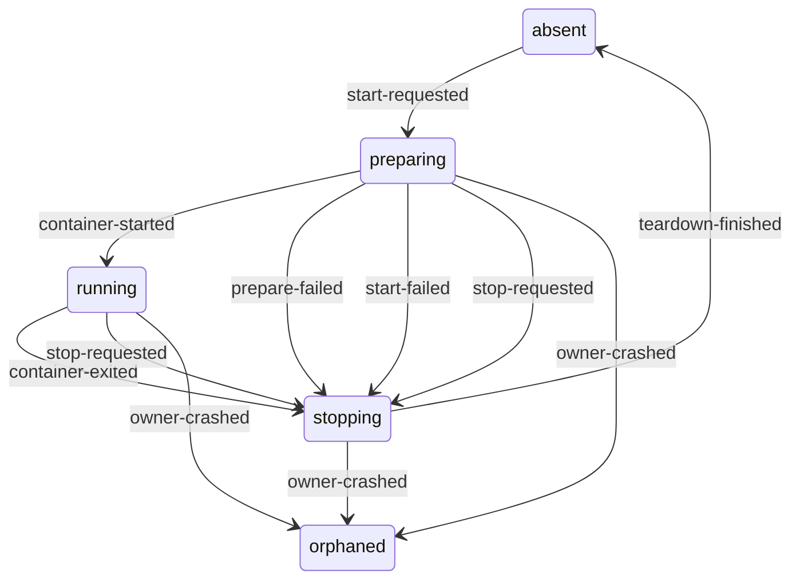

# Pi container lifecycle

The Docker container that runs Pi, together with the child resources acquired
for it. An interactive [Pi session](pi-session.md) owns one at a time; each
scheduled task attempt owns its own. This file covers what must exist, and what
must be removed, regardless of which owner ended it.

## Ownership

- **Created by:** the runner, for an interactive Pi session or a task attempt.
- **Ended by:** the same runner, through the teardown in `BOX-E2A8D2BF`, or by
  restart reconciliation after that runner crashed.
- **Identity:** a random session ID. Docker names the container
  `integral-<session ID>` and each stdio MCP sidecar
  `integral-mcp-<session ID>-<connection>`.
- **Owns:** the temporary session home and the repository checkouts inside it,
  the gateway session identity, every stdio MCP sidecar, resource session
  markers, history mounts, and the run record.

## States

| State | Meaning | Recorded in | After a runner crash |
| --- | --- | --- | --- |
| `absent` | Nothing exists for this session ID. | Nothing. | Nothing to recover. |
| `preparing` | Children are being acquired; the Docker container has not started. | Runner memory; the session home and markers on disk; the gateway identity in gateway memory. | Children on disk become orphans. |
| `running` | The Docker container is running. | Runner memory; Docker; the run record says `running`. | The container, sidecars, and session home become orphans. |
| `stopping` | Teardown has begun and has not finished. | Runner memory only. | Whatever was not yet removed becomes an orphan. |
| `orphaned` | Resources exist on disk or in Docker, but no live runner owns them. | Docker names, session-home directories, resource markers, and run records. | Unchanged until a runner starts. |

## Events

| Event | Source |
| --- | --- |
| `start-requested` | An owner begins provisioning for a session or task attempt. |
| `prepare-failed` | Acquiring a child failed before `docker run`. |
| `container-started` | `docker run` spawned the container. |
| `start-failed` | `docker run` failed. |
| `container-exited` | The container exited without being stopped, including a task's natural exit. |
| `stop-requested` | The owner asked for teardown. |
| `grace-expired` | Five seconds passed after SIGTERM and the container still runs. |
| `teardown-finished` | The container and every child are gone. |
| `docker-unavailable` | The Docker daemon stopped answering, or a Docker command did not return. |
| `owner-crashed` | The runner process died without running teardown. |
| `runner-started` | A runner started for the same deployment. |

## Transitions

| From | Event | To | Outcome | Contract |
| --- | --- | --- | --- | --- |
| `absent` | `start-requested` | `preparing` | Creates a fresh session home and gateway identity and prepares governed connection capabilities. | BOX-AB639757, SCHEDULE-033C050E |
| `absent`, `stopping`, `orphaned` | `prepare-failed` | — | Only a preparing container acquires children. | impossible |
| `absent`, `running`, `orphaned` | `container-started` | — | Only a preparing container starts. | impossible |
| `absent`, `running`, `orphaned` | `start-failed` | — | Only a preparing container starts. | impossible |
| `absent`, `preparing` | `container-exited` | — | No container is running. | impossible |
| `absent` | `stop-requested` | — | Teardown is safe to run when nothing was acquired. | ignored |
| `absent`, `preparing`, `running`, `orphaned` | `grace-expired` | — | The grace period starts with SIGTERM during teardown. | impossible |
| `absent`, `preparing`, `running`, `orphaned` | `teardown-finished` | — | Only a stopping container finishes teardown. | impossible |
| `absent` | `docker-unavailable` | — | The next start reports it as `start-failed`. | ignored |
| `absent` | `owner-crashed` | — | Nothing was acquired. | ignored |
| `absent` | `runner-started` | — | Nothing was acquired. | ignored |
| `preparing` | `start-requested` | — | An owner provisions each session ID once. | impossible |
| `preparing` | `prepare-failed` | `stopping` | Releases every child acquired so far; the owner returns the claimed work. | BOX-C28F4A61, BOX-E2A8D2BF |
| `preparing` | `container-started` | `running` | The container runs with the required restrictions and mounts. | BOX-AB639757, BOX-601613D4 |
| `preparing` | `start-failed` | `stopping` | Releases every child acquired so far; the owner returns the claimed work. | BOX-C28F4A61, BOX-E2A8D2BF |
| `preparing` | `stop-requested` | `stopping` | Stops preparing so that no container starts after shutdown. | SERVER-33E00BBA, BOX-E2A8D2BF |
| `preparing` | `docker-unavailable` | — | The pending `docker run` reports it as `start-failed`. | ignored |
| `preparing` | `owner-crashed` | `orphaned` | Children acquired so far are left on disk. | RUN-B1D837E0 |
| `preparing`, `running`, `stopping` | `runner-started` | — | A runner lock allows one runner per deployment, so the owner is still alive. | impossible |
| `running` | `start-requested` | — | The container already runs. | impossible |
| `running` | `prepare-failed` | — | Preparation has finished. | impossible |
| `running` | `container-exited` | `stopping` | An interactive owner reports an interruption; a task owner judges the declared outcome; either way teardown follows. | FAILURE-071CB99A, SCHEDULE-930581F7, BOX-E2A8D2BF |
| `running` | `stop-requested` | `stopping` | Sends SIGTERM and begins teardown. | BOX-E2A8D2BF |
| `running` | `docker-unavailable` | ? | What does the runner do when the daemon goes away under a running container? Today nothing notices until a prompt or stop fails, and `stop` can then wait forever for the Docker CLI. | open |
| `running` | `owner-crashed` | `orphaned` | The container, sidecars, and session home are left behind. | RUN-B1D837E0 |
| `stopping` | `start-requested` | — | A stopping session ID is never reused. | impossible |
| `stopping` | `container-started` | `stopping` | A container that starts after teardown began is stopped too. | SERVER-33E00BBA, BOX-E2A8D2BF |
| `stopping` | `start-failed` | — | Nothing started; teardown continues. | ignored |
| `stopping` | `container-exited` | — | Teardown expects the exit and continues removing children. | ignored |
| `stopping` | `stop-requested` | ? | Should a second stop request wait for the teardown already in progress? Today it returns at once, so a shutdown can finish before the first teardown removes the container. | open |
| `stopping` | `grace-expired` | `stopping` | Force-removes the container. | BOX-E2A8D2BF |
| `stopping` | `teardown-finished` | `absent` | Nothing of the session remains. | BOX-E2A8D2BF |
| `stopping` | `docker-unavailable` | ? | Each teardown step waits for Docker with no time limit. What bound applies, and what is left for restart reconciliation? | open |
| `stopping` | `owner-crashed` | `orphaned` | Whatever teardown had not removed is left behind. | RUN-B1D837E0 |
| `orphaned` | `start-requested` | — | Session IDs are random and never reused. | impossible |
| `orphaned` | `container-exited` | — | Docker removes an exited `--rm` container; the session home and sidecars remain for reconciliation. | ignored |
| `orphaned` | `stop-requested` | — | No live owner exists to request it. | impossible |
| `orphaned` | `docker-unavailable` | — | Nothing acts on an orphan until a runner starts. | ignored |
| `orphaned` | `owner-crashed` | — | The owner is already gone. | impossible |
| `orphaned` | `runner-started` | ? | Should a starting runner find and remove every container, sidecar, session home, gateway identity, and resource marker a crashed runner left? Today it removes only containers holding a host-repository checkout, after recovering their work (REPO-BB20CA23), and marks unfinished runs interrupted (RUN-B1D837E0). Session homes, `integral-mcp-*` sidecars, containers without a repository checkout, and store markers are never removed. | open |

## Invariants

- No real credential is present in the container, its files, its arguments, or
  its Docker metadata. CONNECTION-0FB2F92A
- After a clean server stop, no Integral container or sidecar remains running.
  SERVER-33E00BBA
- Every container, sidecar, session home, and resource marker has a live owner
  or is removed by restart reconciliation. open
- Every teardown step finishes within a bounded time, even when Docker does not
  answer. open
- Teardown can run after a partial start, and again after an earlier teardown,
  without failing or disturbing another session. AGENTS.md requires it, but no
  behavior specifies it yet. open
- A failure at any provisioning step, including steps before `docker run`,
  releases every child already acquired. BOX-C28F4A61

## Restart reconciliation

- A runner starts from no in-memory containers. Everything a crashed runner
  left is `orphaned`.
- Unfinished run records are marked interrupted. RUN-B1D837E0
- Repository checkouts with unlanded work are recovered before their container
  is removed. REPO-BB20CA23
- Orphans are recognised today only by host-repository session markers. Docker
  labels, or a scan of `integral-*` names and `session-homes/`, would let a
  runner find the rest. open

## Diagram

