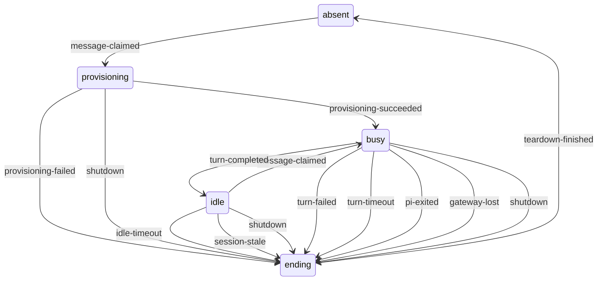

# Pi session lifecycle

The warm Pi RPC conversation the runner keeps for interactive talk. One session
serves turns from the durable message queue until it goes idle, fails, becomes
stale, or the runner stops. Scheduled task attempts do not use this session;
their containers follow [`pi-container.md`](pi-container.md) directly.

## Ownership

- **Created by:** the runner, when it claims a message and no usable session
  exists.
- **Ended by:** the runner, through the container teardown in `BOX-E2A8D2BF`.
- **Identity:** one session per runner, bound to one conversation, one model
  selection, one Pi image, and the session generation it was provisioned with.
- **Owns:** exactly one [Pi container](pi-container.md) and, through it, the
  session home, gateway session identity, MCP sidecars, and run record.
- **Depends on:** the coordinator for claimed messages, the gateway for egress,
  and the [connections](connection.md) of the generation it was provisioned
  with.

## States

| State | Meaning | Recorded in | After a runner crash |
| --- | --- | --- | --- |
| `absent` | No session exists. | Nothing. | Nothing to recover. |
| `provisioning` | A message is claimed and the container and its children are being prepared. | Runner memory; the message is `in-flight` in the coordinator. | The message stays `in-flight` until the coordinator restarts; half-built children become orphans. |
| `idle` | Pi is running with no turn in flight and the idle timer is armed. | Runner memory; container in Docker. | The container and its children become orphans. |
| `busy` | A turn is in flight. | Runner memory; the message is `in-flight`; the run record is `running`. | As `provisioning`, and the run record is later marked interrupted. |
| `ending` | Teardown is in progress. | Runner memory only. | Whatever teardown had not removed becomes an orphan. |

## Events

| Event | Source |
| --- | --- |
| `message-claimed` | The runner claims the next queued message for this conversation. |
| `provisioning-succeeded` | The container started and the first prompt was sent. |
| `provisioning-failed` | Any provisioning step failed, from the session home to the first prompt. |
| `turn-completed` | Pi ended the final attempt of a turn successfully. |
| `turn-failed` | Pi rejected the prompt, ended its final attempt with a provider error, or the prompt failed with a gateway or container error. |
| `turn-timeout` | The turn deadline expired. |
| `pi-exited` | The Pi process or container exited without being asked to. |
| `idle-timeout` | The idle timer fired. |
| `session-stale` | The connection or session generation advanced, the model selection or Pi image changed, an approval continuation started, or the MCP catalog changed. |
| `gateway-lost` | Gateway state disappeared or reported a deployment-wide failure. |
| `shutdown` | The runner received a stop request or a signal. |
| `teardown-finished` | Container teardown completed. |

## Transitions

| From | Event | To | Outcome | Contract |
| --- | --- | --- | --- | --- |
| `absent` | `message-claimed` | `provisioning` | Starts a fresh session and restores the durable conversation context. | BOX-AB639757, CHAT-B46C81F5 |
| `absent`, `idle`, `busy`, `ending` | `provisioning-succeeded` | — | Only a provisioning session can finish provisioning. | impossible |
| `absent`, `idle`, `busy`, `ending` | `provisioning-failed` | — | Only a provisioning session can fail provisioning. | impossible |
| `absent`, `provisioning`, `idle` | `turn-completed` | — | No turn is in flight. | impossible |
| `absent`, `provisioning`, `idle` | `turn-failed` | — | No turn is in flight. | impossible |
| `absent`, `provisioning`, `idle` | `turn-timeout` | — | The turn deadline starts with the prompt. | impossible |
| `absent` | `pi-exited` | — | No Pi process exists. | impossible |
| `absent` | `idle-timeout` | — | A timer left over from an ended session finds nothing to end. | ignored |
| `absent` | `session-stale` | — | The next session reads the current generation and selection. | ignored |
| `absent` | `gateway-lost` | `absent` | The runner marks itself degraded and claims no work. | FAILURE-3780301D |
| `absent` | `shutdown` | `absent` | The runner stops with nothing to tear down. | SERVER-33E00BBA |
| `absent`, `provisioning`, `idle`, `busy` | `teardown-finished` | — | Only an ending session runs teardown. | impossible |
| `provisioning` | `message-claimed` | — | The runner holds one claim at a time. | impossible |
| `provisioning` | `provisioning-succeeded` | `busy` | Sends the claimed message as a Pi `prompt` command. | BOX-AB639757 |
| `provisioning` | `provisioning-failed` | `ending` | Returns the message to its prior queue position, records and reports the failure, and tears down whatever was acquired. | BOX-C28F4A61, BOX-E2A8D2BF |
| `provisioning` | `pi-exited` | ? | Should provisioning wait for an RPC readiness answer from Pi, so a container that exits at once is a provisioning failure? Today start waits only for the Docker process to spawn, so the exit surfaces at the first prompt as a turn failure. | open |
| `provisioning` | `idle-timeout` | — | The idle timer is armed only while idle. | impossible |
| `provisioning` | `session-stale` | `provisioning` | Provisioning continues with the snapshot it read; the session is replaced before its next turn. | CONNECTION-12C87631 |
| `provisioning` | `gateway-lost` | ? | Should provisioning stop and return the message when the gateway disappears? Today it fails only if a later step happens to call the gateway. | open |
| `provisioning` | `shutdown` | `ending` | Stops provisioning, returns the message, and leaves no container running. | SERVER-33E00BBA, BOX-E2A8D2BF |
| `idle` | `message-claimed` | `busy` | Cancels the idle timer and sends the message to the same Pi process and session. | BOX-B45DEA9B |
| `idle` | `pi-exited` | ? | Should the runner end the session as soon as an idle Pi exits, so the next message starts a fresh session? Today nothing reacts until the next prompt fails, which spends one delivery attempt and appends an error event. | open |
| `idle` | `idle-timeout` | `ending` | Recycles the session while keeping the conversation, queue, and terminals. | BOX-7D3A19E4 |
| `idle` | `session-stale` | `ending` | Ends the stale session before the next turn; the next claim provisions a replacement. | CONNECTION-12C87631, BOX-40521095 |
| `idle` | `gateway-lost` | ? | Should a gateway outage end a warm idle session? Today any gateway error at claim time ends it, even a short blip. | open |
| `idle` | `shutdown` | `ending` | Tears down the session. | SERVER-33E00BBA, BOX-E2A8D2BF |
| `busy` | `message-claimed` | — | A conversation has at most one in-flight message; steering is not a claim. | impossible |
| `busy` | `turn-completed` | `idle` | Publishes the response, completes the message, and arms the idle timer when the queue is empty. | BOX-B45DEA9B, BOX-7D3A19E4, FAILURE-BE6D295B |
| `busy` | `turn-failed` | `ending` | Reports the error, returns the message, and tears down the container. | FAILURE-A4C19E72, FAILURE-BE6D295B, FAILURE-3780301D |
| `busy` | `turn-timeout` | `ending` | Reports the timeout, returns the message, and tears down the container. | BOX-BE26C696 |
| `busy` | `pi-exited` | `ending` | Reports the interruption, returns the message, and tears down the container. | FAILURE-071CB99A |
| `busy` | `idle-timeout` | — | Claiming the message cancels the idle timer before the turn starts. | impossible |
| `busy` | `session-stale` | `busy` | The turn finishes; the session is replaced before the next turn. | CONNECTION-12C87631, BOX-40521095 |
| `busy` | `gateway-lost` | `ending` | The prompt fails with a gateway error; the message returns to the queue. | FAILURE-3780301D |
| `busy` | `shutdown` | `ending` | Returns the in-flight message and tears down the container. | SERVER-33E00BBA, SERVER-E3A74B10 |
| `ending` | `message-claimed` | ? | Should a claim wait for the previous session's teardown? Today a replacement provisions in parallel, so two containers and two sets of sidecars can exist briefly. | open |
| `ending` | `turn-completed` | — | Teardown clears the pending turn first. | impossible |
| `ending` | `turn-failed` | — | Teardown is already running; a late failure must not start a second one. | ignored |
| `ending` | `turn-timeout` | — | Teardown is already running; a late turn timer must not start a second one. | ignored |
| `ending` | `pi-exited` | — | Teardown expects Pi to exit. | ignored |
| `ending` | `idle-timeout` | — | Teardown cancels the idle timer. | ignored |
| `ending` | `session-stale` | — | The next session reads the current generation and selection. | ignored |
| `ending` | `gateway-lost` | — | Gateway identities live in gateway memory, so a lost gateway has already dropped this one. | ignored |
| `ending` | `shutdown` | `ending` | Shutdown waits for the teardown in progress and leaves no container running. | SERVER-33E00BBA |
| `ending` | `teardown-finished` | `absent` | The runner may provision a replacement for the next message. | BOX-E2A8D2BF, BOX-7D3A19E4 |

## Invariants

- A claimed message either belongs to the turn of a live session or is
  durably back in the queue. QUEUE-F0C937AD, FAILURE-071CB99A, SERVER-33E00BBA
- When the runner alone crashes in separate-process mode, its in-flight
  message is returned without waiting for a coordinator restart. open
- A message that fails every time it is delivered stops being retried after a
  bounded number of attempts and is reported to the user. open
- An idle session with an empty queue always has an armed idle timer.
  BOX-7D3A19E4
- A session never runs a turn on a connection generation, model selection, or
  image older than the one current when the turn was claimed.
  CONNECTION-12C87631, BOX-40521095
- At most one interactive Pi session, and so one interactive container, exists
  per runner at any moment, including while a replacement is provisioned.
  open

## Restart reconciliation

- Session state lives only in runner memory, so a restarted runner always
  starts from `absent`.
- The coordinator returns `in-flight` and `steering` messages to the queue
  when it loads the queue. QUEUE-F0C937AD
- Run records left `running` are marked interrupted. RUN-B1D837E0
- Containers, sidecars, session homes, and resource markers left behind are
  reconciled as [`pi-container.md`](pi-container.md) describes.

## Diagram

