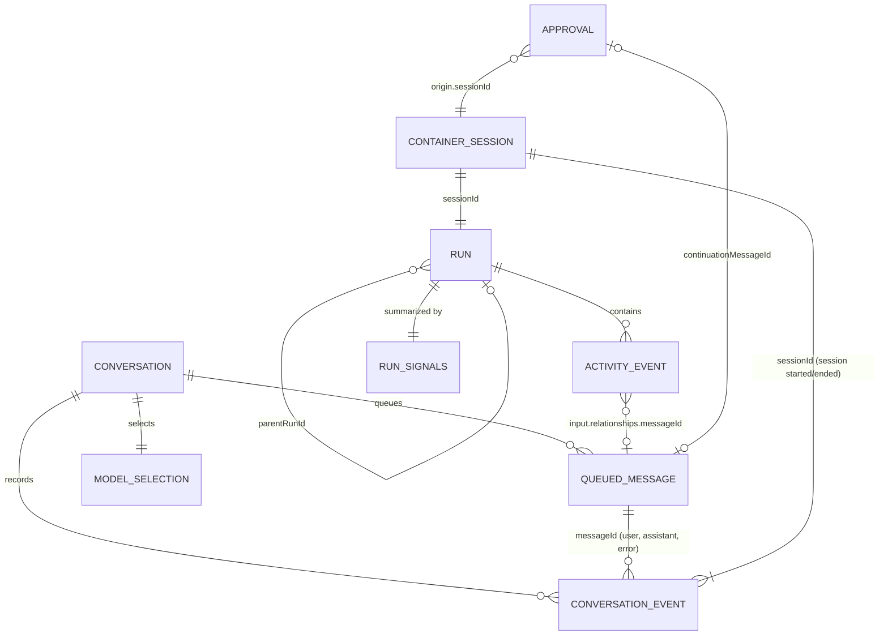
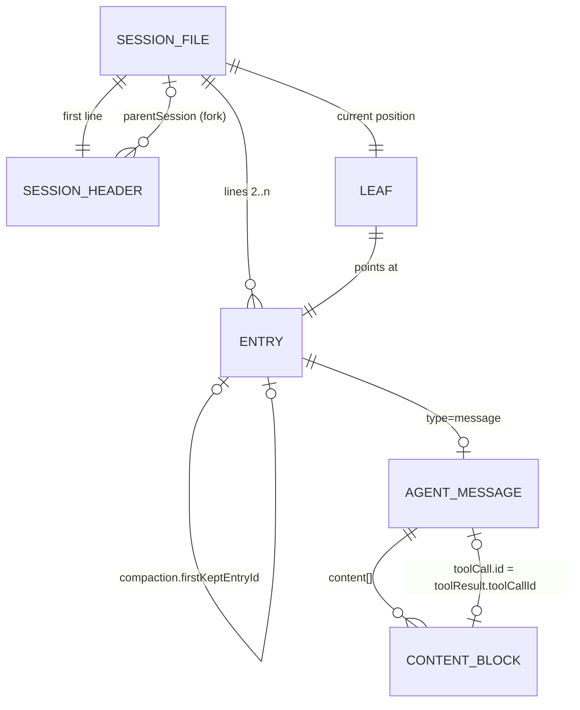
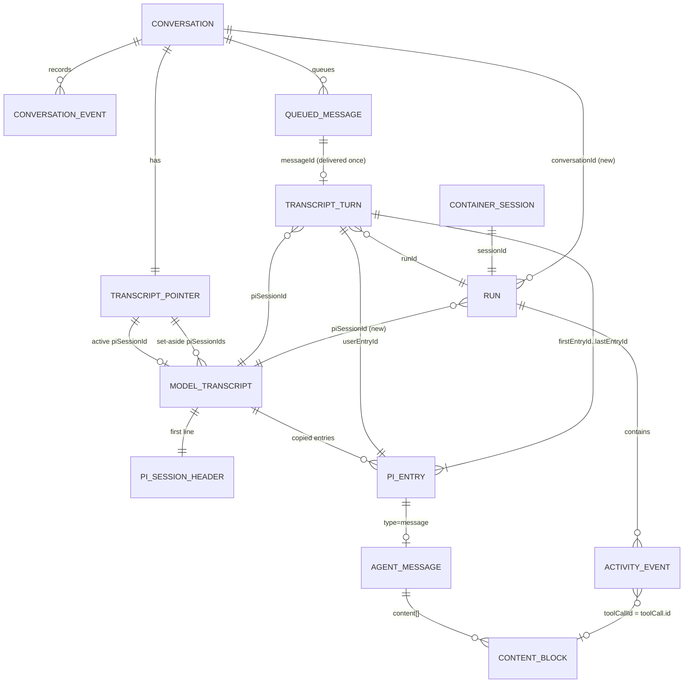
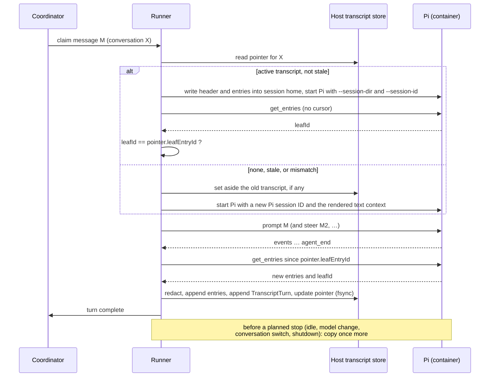

# Design: building Integral's conversation memory on Pi's session model

Status: design draft for review. No behavior IDs are assigned yet. Once this
design is agreed, a behavior spec will follow.

## 1. The question

Integral runs Pi with `--no-session`. When a Pi container is replaced, which
happens after an idle timeout, a model change, a switch to another
conversation, a restart or an approval continuation, the next container gets
the conversation back as plain text:

```text
Continue this durable conversation. Prior messages:
user: …
assistant: …
```

Can Integral use Pi's own session data model for what the model remembers,
instead of keeping a separate, lossy one? This document describes:

- both data models as they exist on disk today,
- how they could be joined, and
- an example of each entity and relationship.

> **About the examples.** Every record below is invented. Each one has the
> exact shape, field names and ID formats that Integral and Pi write today,
> checked against real files, but the IDs, text and numbers are made up. No
> data from a real deployment or a real Pi session appears in this document.

## 2. Terminology: two different "sessions"

Both systems use the word _session_, and they mean different things. Any design
that joins them has to name the difference first.

| Term in this doc      | What it is                                                                                            | Identified by                                                     | Lifetime                                         |
| --------------------- | ----------------------------------------------------------------------------------------------------- | ----------------------------------------------------------------- | ------------------------------------------------ |
| **Container session** | Integral's `sessionId`: one Pi container, from start to teardown, with its gateway identity and token | UUID, for example `0b6c2f4e-5a1d-4e8b-9c3f-7d2a1e6b8f40`          | Minutes (the default idle timeout is 300 s)      |
| **Pi session**        | Pi's session: a JSONL tree of entries, which is what the model remembers                              | Pi session ID, for example `2c9e7a10-4b3d-7f21-8e6a-15d0c4b9a372` | Today the same as the container (`--no-session`) |
| **Model transcript**  | _New._ Integral's host-owned copy of one Pi session that continues across container sessions          | Pi session ID, recorded per conversation                          | As long as the conversation (until set aside)    |

Today one container session has exactly one in-memory Pi session, which is
discarded. In the proposed design, **many container sessions resume one Pi
session**, which the model transcript holds on the host.

## 3. Integral's data model today

### 3.1 Entities

| Entity                | Where it lives                                                                   | Key                                  | Notes                                                                                                     |
| --------------------- | -------------------------------------------------------------------------------- | ------------------------------------ | --------------------------------------------------------------------------------------------------------- |
| **Conversation**      | `data/` (terminal) or `data/channels/discord-<channel>/`                         | `terminal` or `discord:<channel>`    | Not a record of its own. It is a directory holding the files below.                                       |
| **ConversationEvent** | `conversation.jsonl`                                                             | `sequence` within the conversation   | `type` is `user`, `assistant`, `error`, `session` or `notification`.                                      |
| **QueuedMessage**     | `queue.json` → `items[]`                                                         | `id`, which is also the `messageId`  | Can be edited or deleted while queued. Optional `origin` and `approvalContinuation`.                      |
| **ModelSelection**    | `conversation-model.json` or `model.json`                                        | one per conversation                 | `connection`, `provider`, `model`, `piVersion`, `piImage`.                                                |
| **ChannelIngress**    | `channels/discord-<channel>/ingress.json`                                        | Discord message ID                   | Prevents the same Discord message being ingested twice.                                                   |
| **ContainerSession**  | Not stored as a record. It appears in `session` events, `run.json` and approvals | `sessionId`                          | Ephemeral session home under `state/session-homes/`.                                                      |
| **Run**               | `data/runs/<runId>/run.json` (and `index.json`)                                  | `runId`                              | One per container session or task attempt. `parentRunId`, `parentSessionId`, `approvalId`, `termination`. |
| **ActivityEvent**     | `data/runs/<runId>/activity.jsonl`                                               | `eventId`, `sequence` within the run | A curated projection of Pi's RPC stream: text deltas, tool start and result, usage, host events.          |
| **RunSignals**        | `data/runs/<runId>/signals.json`                                                 | `runId`                              | Counts, usage totals and outcome.                                                                         |
| **Approval**          | `data/approvals.json`                                                            | approval `id`                        | `origin` holds `sessionId`, `runId` and conversation; `continuationMessageId` is set later.               |
| **ScheduledTask**     | `data/task-queue.json`                                                           | `executionId`                        | Out of scope: tasks deliberately get no conversation memory.                                              |

### 3.2 Relationships



The code shows three gaps in these relationships:

- **`run.json` does not say which conversation a run served.** The runner
  knows the conversation ID when it starts a run, but `runs.begin()` does not
  store it. It can only be recovered by finding the `input` activity event's
  `messageId` in some conversation's `conversation.jsonl`.
- **`parentRunId` crosses conversations.** When no continuation applies, the
  runner fills it from `runs.latestFinalized("interactive")`, which is the
  latest finished interactive run in the whole deployment. A Discord run can
  therefore have a terminal run as its parent.
- **Assistant text is the only part of a turn the conversation keeps.** Tool
  calls and results exist only in `activity.jsonl`, and the restored context
  reads only `conversation.jsonl`.

### 3.3 Examples

The examples follow one invented turn: a Discord user asks "What schedules are
running?" and Pi answers by calling Integral's `schedule_list` tool.

**ConversationEvents for that turn:**

```json
{"type":"user","messageId":"K3Q7T2M9X1A","text":"What schedules are running?","origin":{"provider":"discord","externalId":"<discord-message-id>","userId":"<discord-user-id>","channelId":"<discord-channel-id>"},"sequence":212,"timestamp":"2026-01-15T09:29:58.120Z"}
{"type":"session","sessionId":"0b6c2f4e-5a1d-4e8b-9c3f-7d2a1e6b8f40","text":"started","sequence":213,"timestamp":"2026-01-15T09:30:00.910Z"}
{"type":"assistant","messageId":"K3Q7T2M9X1A","text":"You have **two enabled schedules**. …","sequence":214,"timestamp":"2026-01-15T09:30:14.402Z"}
{"type":"session","sessionId":"0b6c2f4e-5a1d-4e8b-9c3f-7d2a1e6b8f40","text":"ended","sequence":215,"timestamp":"2026-01-15T09:35:15.030Z"}
```

**A notification.** It is part of the conversation record but never part of
model context. In a channel with active schedules, notifications can far
outnumber user and assistant messages.

```json
{
  "type": "notification",
  "text": "Created task 7d41c0e2-…: Write the weekly summary. …",
  "sequence": 198,
  "timestamp": "2026-01-14T18:02:11.500Z"
}
```

**ModelSelection** (`model.json` in the channel directory):

```json
{
  "connection": "openai-codex",
  "provider": "openai-codex",
  "model": "example-model",
  "piVersion": "0.85.1",
  "piImage": "sha256:5e1f…"
}
```

**Run**, the container session that served `K3Q7T2M9X1A`
(`runs/2026-01-15T09-30-00-000Z-a1b2c3d4/run.json`):

```json
{
  "schemaVersion": 1,
  "runId": "2026-01-15T09-30-00-000Z-a1b2c3d4",
  "kind": "interactive",
  "status": "finalized",
  "sessionId": "0b6c2f4e-5a1d-4e8b-9c3f-7d2a1e6b8f40",
  "model": {
    "connection": "openai-codex",
    "provider": "openai-codex",
    "model": "example-model",
    "piVersion": "0.85.1",
    "piImage": "sha256:5e1f…"
  },
  "startedAt": "2026-01-15T09:30:00.000Z",
  "limits": { "turnTimeoutSeconds": 1800, "idleTimeoutSeconds": 300 },
  "parentRunId": "2026-01-15T09-12-40-000Z-e5f6a7b8",
  "finishedAt": "2026-01-15T09:35:15.000Z",
  "elapsedMs": 315000,
  "termination": "idle"
}
```

No field names the Discord conversation. Here `parentRunId` points at a
terminal-conversation run, which is the cross-conversation link described in
§3.2.

**ActivityEvents for the same turn.** Most `output-delta` events are left out:

```json
{"sequence":1,"source":"host","type":"resource-projection","data":{"repositories":[{"name":"notes","mount":"/home/pi/notes","commit":"9a1c…"}]}}
{"sequence":2,"source":"host","type":"runtime-context","data":{"text":"Continue this durable conversation. Prior messages:\nuser: …\nassistant: …"}}
{"sequence":3,"source":"user","type":"input","data":{"category":"original-request","text":"What schedules are running?","relationships":{"messageId":"K3Q7T2M9X1A","runId":"2026-01-15T09-30-00-000Z-a1b2c3d4"}}}
{"sequence":4,"source":"provider","type":"usage","data":{"provider":{"input":12400,"output":12,"cacheRead":0,"totalTokens":12412}}}
{"sequence":5,"source":"pi","type":"tool-start","data":{"type":"tool_execution_start","toolCallId":"call_ex01|fc_ex01","toolName":"schedule_list","args":{}}}
{"sequence":6,"source":"pi","type":"tool-result","data":{"type":"tool_execution_end","toolCallId":"call_ex01|fc_ex01","toolName":"schedule_list","result":{"content":[{"type":"text","text":"[{\"id\":\"7d41c0e2-…\",\"trigger\":{\"type\":\"recurring\",\"cron\":\"0 18 * * 0\"}, …}, …]"}]}}}
{"sequence":7,"source":"pi","type":"output-delta","data":{"text":"You"}}
{"sequence":58,"source":"provider","type":"usage","data":{"provider":{"input":1900,"output":210,"cacheRead":12288,"totalTokens":14398}}}
{"sequence":59,"source":"pi","type":"output","data":{"text":"You have **two enabled schedules**. …"}}
```

## 4. Pi's data model

This section covers Integral's current runtime, **Pi 0.85.1**, and notes what
Pi 1.3.0 adds.

### 4.1 Entities

| Entity                                                        | Shape                                                                                                          | Key                                | Notes                                                                                                           |
| ------------------------------------------------------------- | -------------------------------------------------------------------------------------------------------------- | ---------------------------------- | --------------------------------------------------------------------------------------------------------------- |
| **SessionFile**                                               | `<session-dir>/<timestamp>_<id>.jsonl`                                                                         | Pi session ID                      | Selected with `--session-dir` and `--session-id` (both exist in 0.85.1).                                        |
| **SessionHeader**                                             | First line: `{"type":"session","version":3,"id","timestamp","cwd","parentSession?"}`                           | `id`                               | Not part of the tree. `get_entries` does not return it.                                                         |
| **Entry**                                                     | Every other line. Has `id` (8 hex characters), `parentId`, `timestamp` and a `type`                            | `id`                               | Entries form a tree. The **leaf** is the current position, and the path from root to leaf is the active branch. |
| `message`                                                     | Holds an **AgentMessage**                                                                                      |                                    | The only entry type the model reads directly.                                                                   |
| `model_change`                                                | `provider`, `modelId`                                                                                          |                                    | Written at session start and when the model changes.                                                            |
| `thinking_level_change`                                       | `thinkingLevel`                                                                                                |                                    |                                                                                                                 |
| `compaction`                                                  | `summary`, `firstKeptEntryId`, `tokensBefore`, `details?`                                                      |                                    | Replaces the history before `firstKeptEntryId` with the summary.                                                |
| `branch_summary`                                              | `fromId`, `summary`                                                                                            |                                    | Created by `/tree` navigation. Integral would not create these.                                                 |
| `custom`                                                      | `customType`, `data`                                                                                           |                                    | Extension state. **Not** part of model context.                                                                 |
| `custom_message`                                              | `customType`, `content`, `display`                                                                             |                                    | Extension message. **Is** part of model context.                                                                |
| `label`, `session_info`                                       | bookmarks, display name                                                                                        |                                    |                                                                                                                 |
| _1.x only:_ `context_edit`, `usage`, `role:"system"` messages | context edits, usage outside messages, prompt and tool checkpoints                                             |                                    | **Same `version: 3` header.** See §9.                                                                           |
| **AgentMessage**                                              | `role` is `user`, `assistant`, `toolResult`, `custom`, `bashExecution`, `compactionSummary` or `branchSummary` | none of its own (the entry's `id`) | Assistant messages carry `provider`, `model`, `usage`, `stopReason` and `responseId`.                           |
| **ContentBlock**                                              | `text`, `thinking` (with a provider signature), `image`, `toolCall` (`id`, `name`, `arguments`)                | `toolCall.id`                      | `toolResult.toolCallId` refers to `toolCall.id`.                                                                |

### 4.2 Relationships



What the model sees is built from the entries: walk from the leaf to the root,
apply the latest compaction, then turn `message`, `compaction`,
`branch_summary` and `custom_message` entries into model messages.

### 4.3 Examples

A short session in which a user asks Pi to count the TypeScript files in a
project. Integral's containers produce no Pi session files yet, because of
`--no-session`.

```json
{"type":"session","version":3,"id":"2c9e7a10-4b3d-7f21-8e6a-15d0c4b9a372","timestamp":"2026-01-10T14:00:00.000Z","cwd":"/home/pi"}
{"type":"model_change","id":"a1f0c3d2","parentId":null,"timestamp":"2026-01-10T14:00:00.100Z","provider":"openai-codex","modelId":"example-model"}
{"type":"thinking_level_change","id":"b2e1d4c3","parentId":"a1f0c3d2","timestamp":"2026-01-10T14:00:00.101Z","thinkingLevel":"medium"}
{"type":"message","id":"c3d2e5f4","parentId":"b2e1d4c3","timestamp":"2026-01-10T14:00:05.000Z","message":{"role":"user","content":[{"type":"text","text":"how many TypeScript files are in src?"}],"timestamp":1768053605000}}
{"type":"message","id":"d4c3f605","parentId":"c3d2e5f4","timestamp":"2026-01-10T14:00:09.000Z","message":{"role":"assistant","content":[{"type":"thinking","thinking":"**Counting files**","thinkingSignature":"{\"id\":\"rs_…\",\"encrypted_content\":\"…\"}"},{"type":"toolCall","id":"call_ex02|fc_ex02","name":"bash","arguments":{"command":"find src -name '*.ts' | wc -l"}}],"provider":"openai-codex","model":"example-model","stopReason":"toolUse"}}
{"type":"message","id":"e5b4a716","parentId":"d4c3f605","timestamp":"2026-01-10T14:00:09.050Z","message":{"role":"toolResult","toolCallId":"call_ex02|fc_ex02","toolName":"bash","content":[{"type":"text","text":"42\n"}],"isError":false,"timestamp":1768053609050}}
{"type":"message","id":"f6a5b827","parentId":"e5b4a716","timestamp":"2026-01-10T14:00:10.500Z","message":{"role":"assistant","content":[{"type":"text","text":"There are 42 TypeScript files in `src`.","textSignature":"{\"v\":1,\"id\":\"msg_…\",\"phase\":\"final_answer\"}"}],"api":"openai-codex-responses","provider":"openai-codex","model":"example-model","usage":{"input":1350,"output":12,"cacheRead":0,"totalTokens":1362},"stopReason":"stop","responseId":"resp_…"}}
```

A failed provider call is stored as an assistant message, and it stays in the
tree:

```json
{
  "type": "message",
  "id": "0a9b8c7d",
  "parentId": "c3d2e5f4",
  "message": {
    "role": "assistant",
    "content": [],
    "provider": "openai-codex",
    "model": "example-model",
    "stopReason": "error",
    "errorMessage": "401 … token expired"
  }
}
```

Extension entries, one outside model context and one inside it:

```json
{"type":"custom","customType":"todo:state","data":{"open":3},"id":"1b2c3d4e","parentId":"f6a5b827"}
{"type":"custom_message","customType":"todo:reminder","content":"Three todo items are still open.","display":false,"id":"2c3d4e5f","parentId":"1b2c3d4e"}
```

A compaction entry, which replaces the history before `firstKeptEntryId` with
its summary:

```json
{
  "type": "compaction",
  "id": "3d4e5f60",
  "parentId": "2c3d4e5f",
  "timestamp": "2026-01-10T16:00:00.000Z",
  "summary": "The user is cleaning up a TypeScript project. …",
  "firstKeptEntryId": "f6a5b827",
  "tokensBefore": 180000
}
```

## 5. What gets lost today

Take the turn from §3.3. Inside the container, Pi's in-memory session held four
messages:

1. `user`: "What schedules are running?"
2. `assistant`: a `toolCall` block for `schedule_list` with `{}`, id
   `call_ex01|fc_ex01`
3. `toolResult`: the full JSON list of schedules, including IDs, cron
   expressions and prompts
4. `assistant`: the formatted answer

The **next** container session for the same conversation receives a
`runtime-context` built by `renderContext()` from `conversation.jsonl`. For
this turn it contains only:

```text
user: What schedules are running?
assistant: You have **two enabled schedules**. …
```

The model loses:

- the tool call, and the fact that it happened;
- the schedule IDs, which appeared only in the tool result;
- its own thinking and signatures. It also loses provider prompt-cache reuse,
  because the history is rebuilt as system-prompt text instead of being
  replayed as messages.

The recap is capped at 200 messages and 100,000 characters. A long-running
conversation reaches that cap, and from then on old turns are dropped, not
summarized. Pi's compaction would summarize them instead.

Conversation switches make container replacement common. The runner destroys
the warm Pi container whenever the next claimed message belongs to a different
conversation (`destroyPi("selection-changed")` in the runner). So alternating
between the terminal and Discord starts a fresh container every time.

## 6. The joined model

### 6.1 The principle

- **The conversation record (`conversation.jsonl`) stays the product's record
  of what happened.** It holds queued messages, edits and deletes before
  delivery, notifications, errors, channel origin and container-session
  markers. Terminals and channels render from it.
- **The model transcript (a host copy of one Pi session) becomes the record of
  what the model has seen.** It holds every message, tool call, tool result,
  thinking block, compaction and model change, in Pi's own format.
- **Join records link the two.** They live in Integral's stores, not inside
  Pi's file.

Pi's file can't be the conversation record. Pi only receives a message when it
is delivered, after it can no longer be edited, so queued messages are not in
it. Notifications and origin don't belong in model context. The file is
written from inside the container by a user the agent's `bash` tool shares.
And Pi decides the format.

### 6.2 New and changed entities

| Entity                | Status  | Where                                                     | Fields                                                                                                                                        |
| --------------------- | ------- | --------------------------------------------------------- | --------------------------------------------------------------------------------------------------------------------------------------------- |
| **ModelTranscript**   | new     | `<conversation dir>/model-transcript/<piSessionId>.jsonl` | Pi's header line followed by Pi entries, appended only, exactly as Pi returned them (after redaction).                                        |
| **TranscriptPointer** | new     | `<conversation dir>/model-transcript.json`                | `piSessionId`, `status` (`active`, `stale` or `set-aside`), `leafEntryId`, `lastPiVersion`, `setAside[]` holding `{piSessionId, reason, at}`  |
| **TranscriptTurn**    | new     | `<conversation dir>/model-transcript/turns.jsonl`         | `messageId`, `steeredMessageIds[]`, `runId`, `sessionId`, `piSessionId`, `userEntryId`, `firstEntryId`, `lastEntryId`, `outcome`              |
| **Run**               | changed | `run.json`                                                | adds `conversationId`, `piSessionId`, `transcriptStartEntryId`, `transcriptEndEntryId`, `contextSource` (`transcript` or `rendered-fallback`) |
| ConversationEvent     | same    | `conversation.jsonl`                                      | Nothing changes. `messageId` is already the join key.                                                                                         |
| ActivityEvent         | same    | `activity.jsonl`                                          | Nothing changes. `toolCallId` already matches Pi's `toolCall.id`.                                                                             |

### 6.3 Relationships across both models



### 6.4 Join keys

| From                                 | To                                       | Key                                                    | Already exists?                          |
| ------------------------------------ | ---------------------------------------- | ------------------------------------------------------ | ---------------------------------------- |
| QueuedMessage                        | ConversationEvent (user/assistant/error) | `messageId`                                            | yes                                      |
| QueuedMessage                        | Run input event                          | `relationships.messageId`                              | yes                                      |
| QueuedMessage                        | TranscriptTurn                           | `messageId`                                            | new                                      |
| TranscriptTurn                       | Pi user-message entry                    | `userEntryId`                                          | new: assigned while copying (§6.5)       |
| TranscriptTurn                       | the turn's Pi entries                    | `firstEntryId..lastEntryId` along the `parentId` chain | new                                      |
| ContainerSession                     | Run, session events, approval origin     | `sessionId`                                            | yes                                      |
| Run                                  | Conversation                             | `conversationId`                                       | **new: missing today**                   |
| Run                                  | ModelTranscript                          | `piSessionId` and the entry range                      | new                                      |
| ActivityEvent tool-start/tool-result | Pi `toolCall` block and `toolResult`     | `toolCallId`                                           | yes. Same string in both, joinable today |
| ModelSelection                       | Pi `model_change` entries                | `provider` and `model`                                 | yes, by value                            |

### 6.5 Linking a delivered message to its Pi entry

Pi assigns entry IDs, and Integral's `prompt` command carries no metadata. There
are two ways to bind `messageId` to `userEntryId`:

- **A: by position (recommended).** Integral sends one `prompt` per turn and
  records the order of steered messages (it already keeps
  `steeredMessageIds`). When copying, the first `user` message entry after the
  cursor belongs to the prompted message. Later `user` entries in the same
  turn belong to the steered messages, in steering order. Integral checks that
  the text matches each time.
- **B: in the transcript.** Integral's Pi extension appends a `custom` entry
  with `customType: "integral.turn"` and `{messageId}` before each prompt.
  That puts the link inside Pi's tree, at the cost of an RPC extension command
  and data that came from the container.

Option A keeps the join entirely on the host.

## 7. Worked example: the same turn, joined

Here is `K3Q7T2M9X1A` as it would be stored under the new design.

**TranscriptPointer**, `channels/discord-<channel>/model-transcript.json`:

```json
{
  "piSessionId": "discord-<channel>-01",
  "status": "active",
  "leafEntryId": "7c1e09ad",
  "lastPiVersion": "0.85.1",
  "setAside": []
}
```

**ModelTranscript**, `channels/discord-<channel>/model-transcript/discord-<channel>-01.jsonl`
(the entries this turn appended):

```json
{"type":"message","id":"3f2a8c10","parentId":"9b04d7e2","timestamp":"2026-01-15T09:30:01.100Z","message":{"role":"user","content":[{"type":"text","text":"What schedules are running?"}]}}
{"type":"message","id":"51d0b6f3","parentId":"3f2a8c10","timestamp":"2026-01-15T09:30:07.400Z","message":{"role":"assistant","content":[{"type":"toolCall","id":"call_ex01|fc_ex01","name":"schedule_list","arguments":{}}],"provider":"openai-codex","model":"example-model","usage":{"input":12400,"output":12,"cacheRead":0,"totalTokens":12412},"stopReason":"toolUse"}}
{"type":"message","id":"a4e9f201","parentId":"51d0b6f3","timestamp":"2026-01-15T09:30:07.410Z","message":{"role":"toolResult","toolCallId":"call_ex01|fc_ex01","toolName":"schedule_list","content":[{"type":"text","text":"[{\"id\":\"7d41c0e2-…\",\"trigger\":{\"type\":\"recurring\",\"cron\":\"0 18 * * 0\"}, …}, …]"}],"isError":false}}
{"type":"message","id":"7c1e09ad","parentId":"a4e9f201","timestamp":"2026-01-15T09:30:14.390Z","message":{"role":"assistant","content":[{"type":"text","text":"You have **two enabled schedules**. …"}],"provider":"openai-codex","model":"example-model","usage":{"input":1900,"output":210,"cacheRead":12288,"totalTokens":14398},"stopReason":"stop"}}
```

**TranscriptTurn**, one line in `turns.jsonl`:

```json
{
  "messageId": "K3Q7T2M9X1A",
  "steeredMessageIds": [],
  "runId": "2026-01-15T09-30-00-000Z-a1b2c3d4",
  "sessionId": "0b6c2f4e-5a1d-4e8b-9c3f-7d2a1e6b8f40",
  "piSessionId": "discord-<channel>-01",
  "userEntryId": "3f2a8c10",
  "firstEntryId": "3f2a8c10",
  "lastEntryId": "7c1e09ad",
  "outcome": "completed"
}
```

**Run**, with the added fields:

```json
{
  "runId": "2026-01-15T09-30-00-000Z-a1b2c3d4",
  "sessionId": "0b6c2f4e-5a1d-4e8b-9c3f-7d2a1e6b8f40",
  "conversationId": "discord:<channel>",
  "piSessionId": "discord-<channel>-01",
  "contextSource": "transcript",
  "transcriptStartEntryId": "9b04d7e2",
  "transcriptEndEntryId": "7c1e09ad",
  "…": "…"
}
```

With these records, each of the following is a lookup instead of a search:

- From the Discord message to the exact model-visible exchange: `messageId` →
  TranscriptTurn → entry range.
- From a tool call in the run archive to the model's view of it: `toolCallId`.
- From a run to the conversation it served: `conversationId`.
- From a run to what the model remembered when it started:
  `transcriptStartEntryId`.

The next container session for this conversation starts Pi on
`discord-<channel>-01`. Pi then rebuilds context with the `schedule_list`
call and result still present.

## 8. Lifecycle

### 8.1 Flows



### 8.2 Invariants

1. **The host copy is written only from Pi's RPC answers.** Integral never
   reads Pi's session file from the container, which the agent can write to.
   The copy inside the session home is thrown away with the container.
2. **Only completed turns are appended.** A turn whose message goes back to the
   queue (timeout, crash, provisioning failure) appends nothing, so
   redelivering the message does not duplicate it in the transcript.
3. **The pointer moves only after the entries are durable.** `leafEntryId`
   changes after the entries and the TranscriptTurn have been fsynced. A crash
   between the two leaves the pointer behind. The next copy then starts from
   the old cursor: Pi returns the entries again, and Integral skips entry IDs it
   already holds.
4. **Resuming is checked.** A transcript counts as resumed only when Pi reports
   the same leaf as the pointer. In every other case Integral falls back to the
   rendered text context and a new Pi session. The old transcript is kept, not
   deleted.
5. **The two records stay separate.** The transcript never receives
   notifications, origin, or queued-but-undelivered messages. The conversation
   record never receives tool calls or thinking.
6. **Scheduled task attempts keep `--no-session`** and have no transcript.

## 9. Risks and open decisions

1. **The Pi version number won't detect a too-new file.** Pi 1.3.0 adds
   `context_edit`, `usage` and `role:"system"` entries, and its header still
   says `version: 3`. A transcript last appended by 1.x and resumed by an
   older Pi image would load with entry types the older Pi doesn't know. The
   pointer therefore records `lastPiVersion`. The runner falls back, rather
   than resuming, when the selected Pi is older than `lastPiVersion`. Is that
   enough, or should Integral also check entry types against a list of known
   types?
2. **The header.** `get_entries` doesn't return the header. Either Integral
   writes it (`version` from the Pi runtime, `id`, a fixed `cwd` of
   `/home/pi`), or it reads Pi's header once from the session file and checks
   it. The proposal is that Integral writes it.
3. **Linking messages to entries:** position (§6.5 A) or a custom entry
   (§6.5 B).
4. **Redaction.** The run archive redacts key patterns such as
   `authorization` and `api_key`. Applying those patterns to the transcript
   would change what the model sees on resume. The proposal is to redact only
   the container session's known secret values (its token), which are dead
   after teardown anyway.
5. **Growth.** Pi's compaction limits model context but not the file. Is a size
   cap, or rotation into a new Pi session seeded from the latest compaction,
   needed?
6. **Set-aside transcripts.** Keep all of them, the latest only, or limit them
   by age?
7. **Prompt cache on resume.** `--append-system-prompt` (resource notes,
   recovery instructions) differs between container sessions. In 0.85.1 this
   is plain system-prompt text. In 1.x it becomes a patch to the recorded
   system message. Either way, the first request after a resume may not hit
   the cache.
8. **Conversation switches.** Should the runner keep one warm Pi per
   conversation instead of destroying it on every switch? That is separate from
   this design, but transcripts make replacing a container cheap enough that it
   matters less.
9. **Existing defects this design brings to light:** `run.json` lacks
   `conversationId`, and `parentRunId` links runs across conversations. Fix
   them here or separately?
10. **Deployment format.** The new files raise `CURRENT_DEPLOYMENT_FORMAT`
    from 2 to 3. The migration does nothing: existing conversations have no
    transcript and fall back once. `integral doctor` gains a reader that checks
    the pointer, the transcript and the turn log against each other.

## 10. Out of scope

- Scheduled task attempts. They stay isolated (SCHEDULE-033C050E).
- Pi's branching (`/tree`, `/fork`). Integral drives a single linear branch.
  `branch_summary` and `label` entries are copied if Pi emits them, but
  Integral never creates them.
- Replacing `activity.jsonl`. The run archive stays the record of what
  happened during a run. The transcript is model memory. They share
  `toolCallId`, and later work could slim one using the other.
